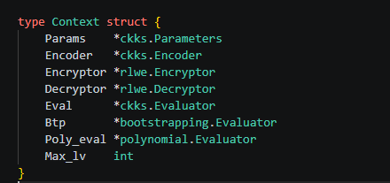

# banded_HED

### Go version

`go version go1.23.3 linux/amd64`

### Project folder

`./lattigo/examples/singleparty/ckks_bootstrapping/slim`

가끔 내부 module을 수정해야 할 때가 있어서, lattigo 폴더를 통째로 넣어놨습니다.
해당 폴더에서 아래 명령어를 실행하면 코드가 돌아갑니다.

```bash
go run .
```

---

## Setup2 : basic parameter

> **이번 setup은 parameter를 설정하는 방법이다.**

`he_module/context.go`에서 CKKS 동형암호의 파라미터를 세팅할 거임.

---

## 1. context 객체



`context.go`에 먼저 **context 객체**를 생성한다.

context 안의 변수들은 코드 작업하면서 필요한 여러 object들을 저장해둔 뒤, 필요할 때마다 불러서 쓴다.

| 변수 | 설명 |
|------|------|
| `Params` | 기본 파라미터 값들이 저장된 객체. lattigo가 지원하는 함수들의 인자로 많이 사용됨. |
| `Encoder` | 복소수 벡터를 다항식으로 encoding하는 객체. 평문 생성에 많이 쓰이고, decoding 기능까지 포함해서 복호화에도 많이 사용됨. |
| `Encryptor` | 다항식을 암호문으로 encryption하는 객체. 암호문 생성할 때 사용. |
| `Decryptor` | 암호문을 다항식으로 복호화하는 객체. |
| `Eval` | 덧셈, 곱셈, 회전, 켤레, 부트스트래핑 등 모든 연산 함수가 들어있는 객체. |
| `Poly_Eval` | 다항식 관련 유틸 함수들을 가지고 있고, 다항식 연산을 수행해주는 객체. 다항식 평가에 자주 사용됨. |
| `Max_lv` | 부트스트래핑 직후 최대 레벨을 저장함. 암호화할 때 사용. |

**여기서부터는 discrete CKKS에서만 사용됨.**

| 변수 | 설명 |
|------|------|
| `logB` | discrete CKKS에서 부트스트래핑할 수 있는 정수의 비트 크기. discrete Bootstrapping에서 주로 사용. |
| `H` | discrete bootstrapping에서 정밀도를 조절하는 크기. `H=0`이면 조절 기능 없음, `H=1`부터 커질수록 노이즈 조절 능력이 강해짐. |

일단은 이렇게 적는데, 코딩 진행하면서 필요하면 추가할 거임.

---

## GenContext 함수


### 1. logN

`LogN`은 쉽게 말하면 암호문의 크기를 나타냄. 보다 정확히는 **RLWE 격자의 차원**.
CKKS의 경우, 이 N에 따라 **보안 · 효율성 · SIMD 처리량**이 모두 좌지우지됨.

### 2. LogDefaultScale

암호문이 지원하는 **메시지의 정밀도**를 나타냄.
encoding은 복소수 벡터를 실수 다항식으로 conversion하지만, RLWE 격자는 **정수 다항식**을 요구함.
그래서 `2^(LogDefaultScale)`만큼 곱하고 rounding을 해서 실수 다항식을 정수 다항식으로 바꿔주는 거임.

> 동형연산에 대한 오차 이전에, 이 rounding 과정에서 이미 정보량을 일부 손실한다고 보면 됨.

### 3. Circuit Level

다른 파라미터를 설명하기 전에, CKKS 암호의 특징을 간략히 짚고 감.

CKKS 암호문에는 **레벨**이라는 개념이 있는데, **한 번 곱셈할 때마다 레벨이 하나씩 줄어드는** 관계임.
레벨이 0이 되면 더 이상 곱셈을 할 수 없음. 그럴 때 하는 게 **bootstrapping**인데,
bootstrapping은 재암호화를 동형적으로 수행하는 연산이라고 보면 됨.
즉, bootstrapping에도 곱셈 같은 게 필요하고 레벨이 사용된다는 뜻.

이제 line 32–37을 배열로 쭈우욱 연결한 게 **CKKS 암호문이 사용 가능한 곱셈의 개수**, 즉 레벨임!

이걸 하나씩 살펴볼 건데, 이것만 기억하면 됨:
아까 부트스트래핑도 레벨을 쓴다고 했잖슴?
**`qiCircuitSlots`를 제외한 모든 배열은 부트스트래핑에 사용되는 레벨임.**

주의할 점은, **lattigo 함수는 레벨을 q0부터 셈.**

| 레벨 | 영역 |
|------|------|
| 0 (q0) | 암호문이 q0에 위치 → 레벨 0 |
| 1–3 (`qiSlotsToCoeff`) | 부트스트래핑 영역 |
| 4 | 곱셈 불가 + 부트스트래핑 필요 |
| 4–9 | 연산 가능한 레벨 |
| 10 ~ 끝 | 전부 부트스트래핑 영역 |

`qiLookUpTable`은 discrete CKKS에 필요한 추가 level들이고, 여기도 bootstrapping 영역임.
앞에서 context에 저장한 `logB + H`만큼 배열 길이를 할당할 거임.

### 4. parameter 변수 초기화

이제 해당 parameter들을 가지고 변수를 선언함.

- `LogN`, `LogQ` : 각각 앞서 선언한 RLWE 차원과 레벨 배열의 총 비트 크기.
- `LogP` : key-switching 영역에 사용되는 추가 레벨.
  - RLWE의 최종 모듈러스 비트는 `LogQ + LogP`가 되며, RLWE 격자에 대해 모듈러스 비트 크기가 커질수록 **보안 레벨이 낮아진다**는 점에 주의.
  - 지금으로썬 항상 3–5개로 두는 걸 권장하며, 각 비트 크기는 `LogQ` 원소의 maximum과 같거나 커야 함. (안 그러면 switching 연산이 제대로 동작 안 함.)
- `Xs` : 비밀키의 분포를 나타냄.
  - 표준적으로 비밀키 분포는 ternary `(-1, 0, 1)`에서 뽑고, 0이 아닌 원소의 개수를 **hamming weight**라고 함.
  - `H`는 hamming weight를 뜻하는데, `H : 192`니까 `-1, 1`이 192개 있다는 뜻.

### 5. Bootstrapping parameter


여기는 부트스트래핑의 각 절차에 대한 파라미터를 조절하는 단계임.

부트스트래핑은 다음 순서로 이루어짐.

1. **CtS** (CoeffsToSlot)
2. **StC** (SlotToCoeffs)
3. **Eval** (EvaluateMod1)
4. **LUT** (EvaluateLookUpTable) — 여기는 이산 버전일 때만 사용.

`CoeffsToSlotsParams`와 `SlotToCoeffsParams`는 일단 이것만 보면 됨.
저 마지막에 있는 배열 `Levels`의 길이가 CtS에 사용되는 레벨의 개수임.
레벨을 줄일수록 느리고, 늘릴수록 속도가 빨라짐.
이건 변수 바꿔가면서 직접 해체쇼 해보길 바람. (이유는 글이 너무 길어져서 생략.)

`Mod1Params`는 Eval 단계에 대한 파라미터임.
주의할 점:

1. `Mod1Params.LogScale`과 `qiEvalMod`의 비트 크기가 일치해야 함.
2. `Mod1Type`은 웬만하면 바꾸지 않음.
3. `qiEvalMod`의 길이는 `Ceil(Log(Mod1Degree)) + DoubleAngle`임.
   `Mod1Degree`와 `DoubleAngle`을 잘 조절하면 부트스트래핑 정밀도를 손볼 수 있음.
4. `K`는 **절대 바꾸지 마셈.** 얘는 Mod1 함수의 근사 영역을 나타내는 건데, 궁금하면 나중에 논문 드림. 그때 읽어보셈.
5. `LogMessageRatio`는 정밀도와 관련된 변수이고, `Logq0 - LogDefaultScale`이 되게끔 설정해야 함.
6. `Mod1InvDegree`는 추가 레벨을 써서 정밀도를 올릴 때 쓰는 건데, 요즘은 잘 안 쓰므로 항상 `0`으로 두는 게 좋음.

---

이제 설명은 다 끝났고, 나머지는 코드 템플릿처럼 작성하면 파라미터 선언이 끝남.

여기까지는 설명에 좀 힘줬는데, 다음 README부터는 시간상 어려울 듯...
사실 코드에 나와 있는 것보다 훨씬 많은 파라미터 조절이 가능함.
공부를 하겠다면 **해체쇼를 꼭 해보길 바람.**