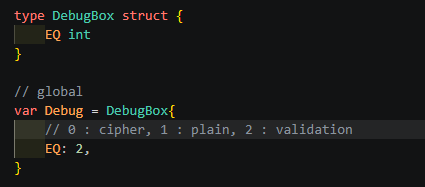
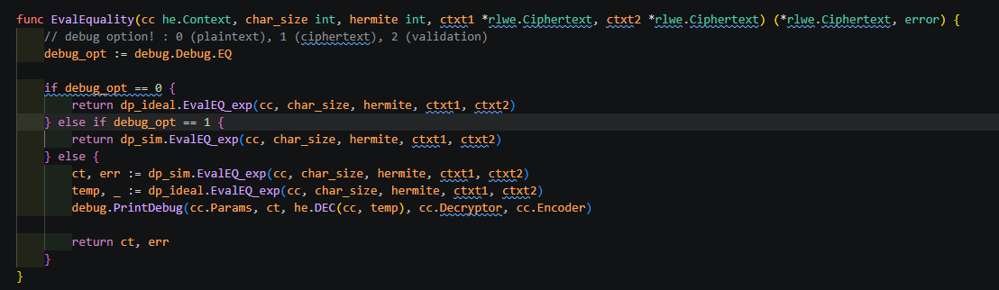
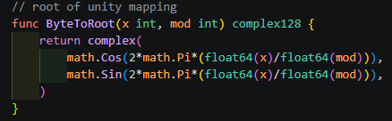

# banded_HED

## 환경

- Go version: `go1.23.3 linux/amd64`
- Project folder: `./lattigo/examples/singleparty/ckks_bootstrapping/slim`

가끔 내부 module을 수정해야 할 때가 있어서, lattigo 폴더를 통째로 넣어놨습니다.
해당 폴더에서 아래 명령어를 실행하면 코드가 돌아갑니다.

```bash
go run .
```

---

오늘은 Equality 함수를 작성해보면서, 동형암호 코드를 작성할 때의 팁을 알려드리려고 합니다.

그 전에...
저도 백준 겨우 골딱이에 개발은 커녕 캡스톤 디자인도 캐리받던 인간인지라... 코딩실력이 매우 개판인데요.
이번 branch를 작성하다가 go언어의 package 순환구조가 터져서 폴더 구조를 많이많이 바꿨습니다.


## 1. 변경사항

### 변경된 폴더 구조

```
slim/
├── debug/
│   └── debug.go
├── dp/
│   ├── dp_ideal/equal.go
│   ├── dp_sim/
│   │   ├── DPtable.go
│   │   └── equal.go
│   ├── dp_module.go
│   └── where.go
├── he/
│   ├── btp.go
│   ├── context.go
│   ├── io.go
│   ├── pack.go
│   └── poly.go
├── test/
│   ├── dp/
│   │   ├── equality_test.go
│   │   └── pack_test.go
│   └── he/
│       └── he_test.go
└── util/
    ├── print.go
    └── sampling.go
```

1. `util/debug.go` 를 `debug/debug.go` 로 옮겼습니다.
   오늘 debug.go에 뭔갈 추가할껀데, 이 파일을 다른 패키지로 옮기는게 컴파일이 깔끔한 것 같아요.
   그래서 debug라는 폴더를 추가하고 여기에 옮겼습니다.

2. `dp/dp_sim/pack.go` 를 `dp/pack.go` 로 옮겼습니다.
   이 친구 덕분에 약 1시간을 삽질했네요.

3. 기존에 작성된 `DPtable.go` 에 있는 함수들 중 몇개를 주석처리한 뒤 `where.go` 에 옮겨놨어요.
   주석처리한 함수들은
   - 당장 필요없어 보이는 함수들
   - 어디에 쓰이는지 모르겠는 함수들
   입니다.

   그리고 아래 함수를 `pack.go` 에 옮겼습니다. 함수 인자는 살짝 변경했어요.

   ```go
   func ByteToRoot(x int, mod int) complex128 {
       return complex(
           math.Cos(2*math.Pi*(float64(x)/float64(mod))),
           math.Sin(2*math.Pi*(float64(x)/float64(mod))),
       )
   }
   ```

4. 아주 많은 함수들의 인자의 이름, 순서 등 자잘자잘한 변경.
   이건 그냥 제 병적인건데, 그때그때 따라 통일성이 없거나 지저분하거나 등 그러면 변경합니다.
   근데 변경하다보니 도대체 뭘 변경했는지 잘 기억이 안나네요. 기억 안나는거 보면 큰건 아닌것 같아요.
   이번 branch는 기존꺼에서 수정하지 말고 그대로 당겨오세요.


## 2. Equality-1 (고수준 API / 디버그 스위치 설계)

일단 오늘은 equality 함수를 작성해볼 껍니다.

우리는 이제부터 module을 만들 때 마다,
- `dp_sim` 에 동형 알고리즘을 하나
- `dp_ideal` 에 SIMD 스타일의 평문 알고리즘을 하나
- 마지막으로 `dp` 에 고수준 API 를 하나 만들꺼에요.

그래서 실제 코드는 dp 에 있는 API만 호출할 것이고, 알고리즘에 문제가 생기면 전역변수 하나만
딸깍 해서 해당 모듈을 디버깅할꺼에요.

먼저 `debug/debug.go` 에 아래와 같은 구조체와 전역변수를 선언해줍니다.



오늘은 Equality 함수를 짤꺼니까 변수명은 `EQ` 로 합니다.
고수준 API에서는 이 전역변수를 참조해서,
- 0 이면 동형연산을
- 1 이면 평문연산을
- 2 이면 둘다 실행시켜서 모듈검증 테스트를 수행할 것입니다.

그래서 API의 최종 코드는 이렇게 될꺼에요.




## 3. Equality-3 : simulator

이제 `dp_sim` 에 동형 알고리즘을 작성해볼께요.
이 알고리즘은 discrete CKKS의 Look-Up Table 연산을 활용하여 equality check를 수행합니다.
보다 정확히는 두 값을 뺀 값이 0이면 1을, 다르면 0을 반환하는 LUT 함수를 평가합니다.

두 입력 x, y는 정수 그대로 암호화되어 있지 않고,
복소평면의 단위원을 `char_sz` 개만큼 등분한 뒤 각각 x번째, y번째 점에 "encoding"되어 암호화되어
있게 할겁니다. encoding 함수는 아래와 같습니다. (mod = char_sz)

    Enc(x) = exp(2*pi*i * x / char_sz)
           = cos(2*pi*x / char_sz) + i * sin(2*pi*x / char_sz)

(`pack.go` 의 `ByteToRoot` 가 이 encoding을 구현합니다.)



보다 자세한 내용은 https://eprint.iacr.org/2024/1637 를 참고하세요.

내부 알고리즘은
먼저 입력 y를 켤레 한 뒤 x랑 곱해줍니다. 복소단위원 매핑상태에서 켤레 연산은 y의 부호를 반전시키는
것과 같아요. 그래서 y → -y 된다고 생각하면 됩니다.
그리고 복소단위원 매핑상태에서 x, y의 곱은 x+y 와 같습니다.
그래서 켤레 이후 곱셈은 x-y를 해주겠다는 거에요.
이후 LUT 연산을 통해서 eq값을 정수 1, 0 으로 return 합니다.

```go
// Note : 현재는 cipher-cipher equality 상태로 작성되어 있습니다. 추후에 수정 예정입니다.
// Input : 각 암호문은 N/2개의 7bit integer가 각각 exp(2pi*i* x/128), exp(2pi*i* y/128) form으로 저장되어 있습니다.
// Output : 출력 암호문은 x==y 이면 1을 그렇지 않으면 0이 저장됩니다.
// description : 1. Compute exp(2pi*i*(x-y)/128) : ctxt2를 conjugation 한 뒤, ctxt1과 곱합니다.
//  2. Hermite Interpolation : equality Look-up Table을 평가합니다.
func EvalEQ_exp(cc he.Context, char_size int, hermite int, ciphertext1 *rlwe.Ciphertext, ciphertext2 *rlwe.Ciphertext) (*rlwe.Ciphertext, error) {

	eval := cc.Eval
	params := cc.Params
	poly_eval := cc.PolyEval

	eq := func(x int) int {
		if x == 0 {
			return 1
		} else {
			return 0
		}
	}

	var err error
	var result *rlwe.Ciphertext

	// ciphertext2 복사본
	ct2Conj := ciphertext2.CopyNew()

	// conjugate : exp(y) ==> exp(-y)
	err = eval.Conjugate(ct2Conj, ct2Conj)
	if err != nil {
		panic(err)
	}

	// mult : exp(x) * exp(-y) ==> exp(x-y)
	result, err = eval.MulRelinNew(ciphertext1, ct2Conj)
	if err != nil {
		panic(err)
	}

	err = eval.Rescale(result, result)
	if err != nil {
		panic(err)
	}

	var f_coeffs bignum.Polynomial

	// hermite order :
	f_coeffs = bignum.NewPolynomial(0, he.HermiteInterpolation(char_size, hermite, eq), nil)

	var poly_f polynomial.Polynomial
	poly_f = polynomial.NewPolynomial(f_coeffs)

	result, err = poly_eval.Evaluate(result, poly_f, params.DefaultScale())
	if err != nil {
		panic(err)
	}

	return result, err
}
```


## 4. Equality-2 : ideal

이제 `dp_ideal` 에 equality 의 평문 알고리즘을 작성해줍시다.
이때,
1. 혹시 모를 상황(?)에 대비하여, 인자는 암호문 연산이 받는 인자와 출력타입을 동일하게 해줄 꺼고
2. 함수 내부에서 복호화를 진행 한 후 평문 연산을 한 뒤, 암호화를 해서 출력해줄 꺼에요.
3. 그리고 피연산자의 레벨과 소모레벨을 계산해서 실제 동형연산의 출력 레벨과 같게 해줄껍니다.

그러기 위해서 `he/io.go` 에 decryption과 encryption 함수를 만들어줍니다.

그런 다음에 아래와 같이 SIMD 스타일의 평문 알고리즘을 작성해줍니다!


이때, 현재 입력 암호문은 복소원 패킹이 되어있는 상태이기 때문에
`he/pack.go` 에서 `RootToByte` 라는 함수를 작성해줍시다. 요즘은 GPT가 일을 참 잘해요.
p.s 이거 때문에 1시간을 또 날렸습니다.

exp form에서 equality를 계산하는 연산은 아래와 같이 깊이를 소모합니다.

    ⌈ log2 |A| ⌉ + 1        (A : input domain)

LaTeX:

    \lceil \log_2 |\mathcal{A}| \rceil + 1, \quad \text{where } \mathcal{A} \text{ : input domain.}

그래서 `out_lv` 을 수식에 맞게 설정해주었습니다.


## 5. Equality-4 : Test

이제 `dp/dp_module.go` 에 고수준 API를 작성해준 뒤, `test/dp/equality_test.go` 에 test 함수를
작성해줍니다.
우리는 동형 알고리즘이 잘 작성되었는지, 즉 validation 을 해야하니
debug 구조체에 있는 `EQ` 값을 2로 setting 한 뒤 test를 돌릴 께요.
validation 은
ideal 함수와 sim 함수를 동일하게 수행한 뒤 두 값의 오차를 분석합니다.
만약 오차가 너무 크다면 값이 다르게 된 거로 생각해야 합니다.

`debug/debug.go` 에 함수를 추가할께요.
먼저 기존 `printDebug` 함수의 이름을 `printNoise` 로 변경하겠습니다.
왜냐하면 이 함수는, 인자의 valueWant를 전혀 사용하지 않고, ciphertext를 복호화한 valuesTest의
값이 얼마나 정수에 가까운지를 보기 때문입니다.

그리고 `printDebug` 라는 함수 이름으로 아래와 같이 추가할께요.
바뀐 점은 real_round 와 imag_round가 valuesTest가 아닌 valuesWant에 있는 점입니다.

```go
func PrintDebug(params ckks.Parameters, ciphertext *rlwe.Ciphertext, valuesWant []complex128, decryptor *rlwe.Decryptor, encoder *ckks.Encoder) (valuesTest []complex128) {

	slots := ciphertext.Slots()

	if !ciphertext.IsBatched {
		slots *= 2
	}

	valuesTest = make([]complex128, slots)

	if err := encoder.Decode(decryptor.DecryptNew(ciphertext), valuesTest); err != nil {
		panic(err)
	}

	max_L2_err := 100.0
	avg_L2_err := 0.0

	for i := 0; i < params.MaxSlots(); i++ {
		// compute real err
		real_round := real(valuesWant[i])
		real := real(valuesTest[i])
		real_err := math.Abs(real_round - real)

		// compute imag err
		imag_round := imag(valuesWant[i])
		imag := imag(valuesTest[i])
		imag_err := math.Abs(imag_round - imag)

		L2_err := math.Sqrt(real_err*real_err + imag_err*imag_err)
		log_L2_err := -1 * math.Log2(L2_err)

		avg_L2_err += log_L2_err
		max_L2_err = min(max_L2_err, log_L2_err)
	}

	fmt.Println()
	fmt.Printf("Level: %d (logQ = %d)\n", ciphertext.Level(), params.LogQLvl(ciphertext.Level()))

	fmt.Printf("Scale: 2^%f\n", math.Log2(ciphertext.Scale.Float64()))
	fmt.Printf("ValuesTest: %10.14f %10.14f %10.14f %10.14f...\n", valuesTest[0], valuesTest[1], valuesTest[2], valuesTest[3])
	fmt.Printf("ValuesWant: %10.14f %10.14f %10.14f %10.14f...\n", valuesWant[0], valuesWant[1], valuesWant[2], valuesWant[3])
	fmt.Println("Average Noise (L2) : ", -1*avg_L2_err/float64(len(valuesTest)))
	fmt.Println("Maximum Noise (L2) : ", -1*max_L2_err)
	//precStats := ckks.GetPrecisionStats(params, encoder, nil, valuesWant, valuesTest, 0, false)

	//fmt.Println(precStats.String())
	fmt.Println()

	return
}
```


## 6. Debugging

이제 우리는 모든 함수를 이렇게 작성할 꺼고, 경우에 따라 아래처럼 진행할꺼에요.
1. 오늘처럼 sim과 ideal을 동시에 만들어서 모듈을 하나하나 만든 뒤 합쳐서 전체 프로그램을 만들기.
2. ideal 부분만 먼저 만든 뒤에, 프로그램이 필요로 하는 모듈의 순서별로, 하나씩 sim으로 만들어서 test를 진행하기.
3. bootstrapping 과 같이 응용레벨에서 다루기 어려운 알고리즘들을 ideal로 만들어서 진행하고, 못하는 것들은 co-worker한테 떠넘기기.

제가 오늘 이거 만드는데만 2시간을 날렸는데, 나중에 진짜 문제가 되는 상황이 발생하면 일주일을
버려야할 때도 있습니다. 그래서 결과적으론 이득이에요.
진짜 문제가 되는 상황은 다음과 같은데,
1. 모듈끼리는 정상인데 이어붙여놓으니까 문제가 되는 경우.
2. 모든게 잘 돌아가는데, 오차가 중첩되서 문제가 생기는 경우.
3. 아직 겪어보지 않은 무언가.

이럴 때, 프로그램 돌리기 전에 debug 변수를 바꿔가면서 특정 모듈을 ideal로 바꿔놓으면 어디서
문제가 발생했는지 알기 쉽고, `printDebug`, `printNoise` 와 같은 함수가 밥값을 합니다.


## 7. 마치며...

equality를 현재 exp에서 돌아가게끔 해놨는데, 나중에는 bit-form 에서의 tree 기반 연산으로
바꿔야할 가능성이 높습니다.
먼저 exp form으로 해놓은 이유는, 편집거리 알고리즘의 사용처가 하나의 독립적인 알고리즘이 아니라,
여러 알고리즘에 사용되는 부품 같은 존재라서 암호문이 어떻게 패킹되어 있는지 특정지을 수 없기
때문이에요.
다행히도 exp form은 discrete bootstrapping 시에 exp form으로 반드시 존재하게 되서
"패킹의 일반성"을 잃진 않습니다.
몇가지를 추가하면 bit-form으로도 변경할 순 있는데, 이게 경우에 따라 말이 안될 수도 있어서
"당장"은 exp-form으로 해놓았습니다.