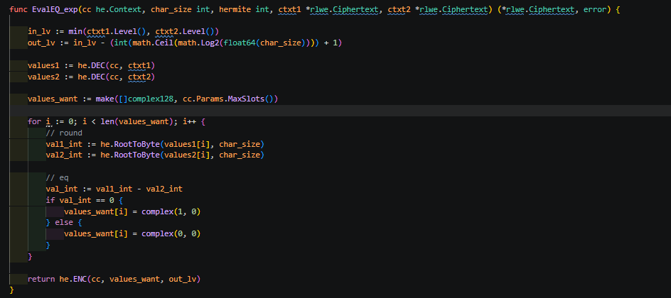

# banded_HED

### Go version

`go version go1.23.3 linux/amd64`

### Project folder

`./lattigo/examples/singleparty/ckks_bootstrapping/slim`

가끔 내부 module을 수정해야 할 때가 있어서, lattigo 폴더를 통째로 넣어놨습니다.
해당 폴더에서 아래 명령어를 실행하면 코드가 돌아갑니다.

```bash
go run .
```

---

---

## Setup3 : bootstrapping

> **이번 setup은 부트스트래핑을 테스트하는 방법이다.**

필자의 경우 파라미터 셋업 이후 부트스트래핑을 먼저 테스트한다.
실수 연산을 위해서도 부트스트래핑 정밀도를 조절하는 게 우선이다.

이 경우, 내가 원하는 정밀도에 대해 **얼마만큼의 레벨을 쓸 수 있는지** 파악하는 게 우선이기도 하다.
(부트스트랩에 필요한 레벨을 조절해가면서 정밀도를 조절할 수 있으므로.)

이산 CKKS에 대해서도 부트스트래핑 디버깅을 먼저 한다.
이산 부트스트래핑의 경우 라이브러리로 만들어진 게 아직 없어서,
항상 직접 작성해서 커스텀해야 하는 부분도 있다.

---

### 1. discrete 용으로 파라미터 변경하기

`context.go`의 `Context`에:

- 필요한 추가 변수 추가
- context 파라미터를 **discrete CKKS 용으로 변경**

파라미터가 어떻게 변경되었는지 체크하길 바란다.

---

### 2. bootstrapping 함수 작성

- `he_module/btp.go` — 부트스트래핑 함수가 작성되어 있다.
- `he_module/util_poly` — 이산 부트스트래핑이 필요로 하는 유틸성 모듈을 작성해두었다.

---

### 3. bootstrapping test 함수 작성 및 test

`he_module/he_test.go`에서 이산 부트스트래핑을 테스트한다.

이산 부트스트래핑은 **노이즈를 제거하는 능력**을 가지고 있다.
이 능력을 알아보기 위해 디버깅용 함수를 추가한다.
이 함수는 실제 디버깅에서 자주 쓸 함수이며, 이름은 **`printDebug`** 이다.



먼저, 노이즈 제거 능력을 확인하기 위해 **노이즈를 추가하는 함수**를 만들어주자. (`printDebug_withNoise`)
이 함수는 테스트용으로만 쓰고 버릴 예정이다.

이제 `debug.go` 파일을 만들고, 여기에 `printDebug` 함수를 추가해주자.
이 함수는 **암호문을 복호화한 평문의 오차를 계산하여 출력**한다.

오차 계산 방식은 이렇다:


- 복호화된 각 데이터와, 그에 **가장 가까운 정수**와의 오차를 log 수준으로 비교한다.
- 이 거리는 **L2 norm**, 즉 `√(실수부² + 허수부²)`로 계산한다.
- 그다음 **슬롯당 평균 오차와 최대 오차**를 계산하여 출력한다.
